# pytestwaf — System Architecture

Eleven Mermaid architecture diagrams covering the runtime data flow, the ML stack, the multi-cloud autofix pipeline, the codebase module map, and the deployment topology. Each diagram renders directly in VSCode (Markdown Preview Mermaid Support), GitHub, or any Mermaid-aware tool. Pre-rendered PNGs are in [diagrams/](diagrams/).

> **Start here:** Diagram 0 below is the 10-second big-picture overview. Diagrams 1–10 zoom into each part of the system in order.

| # | Diagram | Image |
|---|---|---|
| 00 | **Big-picture overview** (start here) | [PNG](diagrams/00-overview.png) · [.mmd](diagrams/00-overview.mmd) |
| 01 | Comprehensive End-to-End Architecture | [PNG](diagrams/01-end-to-end.png) · [.mmd](diagrams/01-end-to-end.mmd) |
| 02 | Training Architecture | [PNG](diagrams/02-training.png) · [.mmd](diagrams/02-training.mmd) |
| 03 | Prediction / Inference Architecture | [PNG](diagrams/03-prediction.png) · [.mmd](diagrams/03-prediction.mmd) |
| 04 | Response Classification (4-Layer Defense in Depth) | [PNG](diagrams/04-classification.png) · [.mmd](diagrams/04-classification.mmd) |
| 05 | Adaptive Mutation Engine (700 ML Mutations) | [PNG](diagrams/05-mutation.png) · [.mmd](diagrams/05-mutation.mmd) |
| 06 | Autofix → Multi-Cloud IaC Pipeline | [PNG](diagrams/06-autofix-iac.png) · [.mmd](diagrams/06-autofix-iac.mmd) |
| 07 | Cross-Scan Knowledge Persistence | [PNG](diagrams/07-persistence.png) · [.mmd](diagrams/07-persistence.mmd) |
| 08 | Reporting Architecture (HTML / 3D / XLSX / CSV) | [PNG](diagrams/08-reporting.png) · [.mmd](diagrams/08-reporting.mmd) |
| 09 | Full Component Architecture (module map) | [PNG](diagrams/09-full-architecture.png) · [.mmd](diagrams/09-full-architecture.mmd) |
| 10 | Deployment Setup Architecture | [PNG](diagrams/10-deployment.png) · [.mmd](diagrams/10-deployment.mmd) |

---

## 0. Big-picture overview (start here)

The whole system in 9 phases. Read top to bottom. Every other diagram in this document is a zoom-in on one of these boxes.


<details>
<summary>Mermaid source</summary>

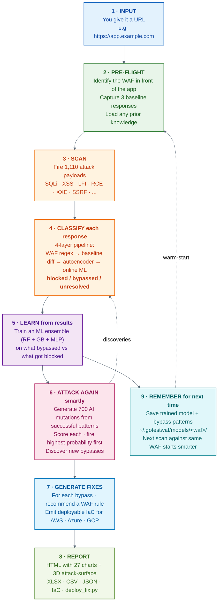

</details>

---

## 1. Comprehensive End-to-End Architecture

The full lifecycle of one scan: CLI invocation → pre-flight → corpus expansion → scanning → ML learning → adaptive mutation → autofix/IaC → HTML/3D report → cross-scan persistence.


<details>
<summary>Mermaid source</summary>

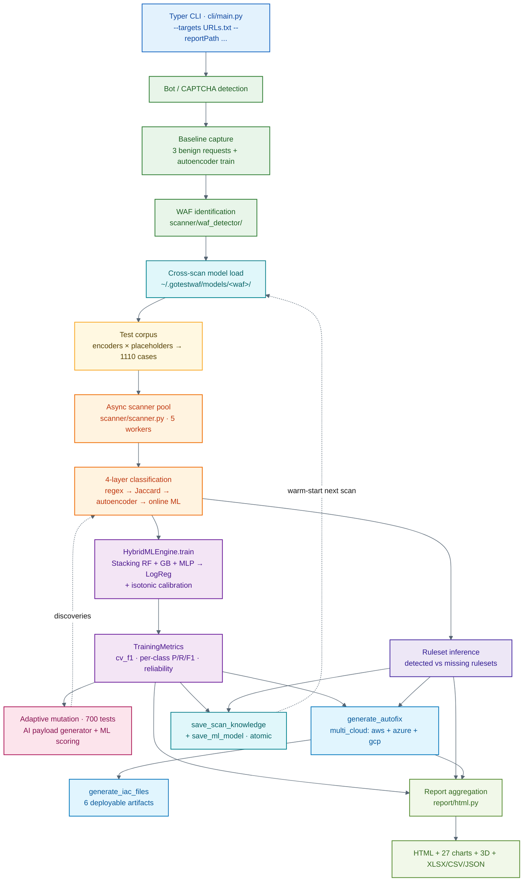

</details>

---

## 2. Training Architecture

How the HybridMLEngine learns from in-flight scan results. Stacking ensemble (RF + GB + MLP) with isotonic calibration, balanced sample weights, and stratified cross-validation. Falls back to RF-only when minority class < 10 samples.

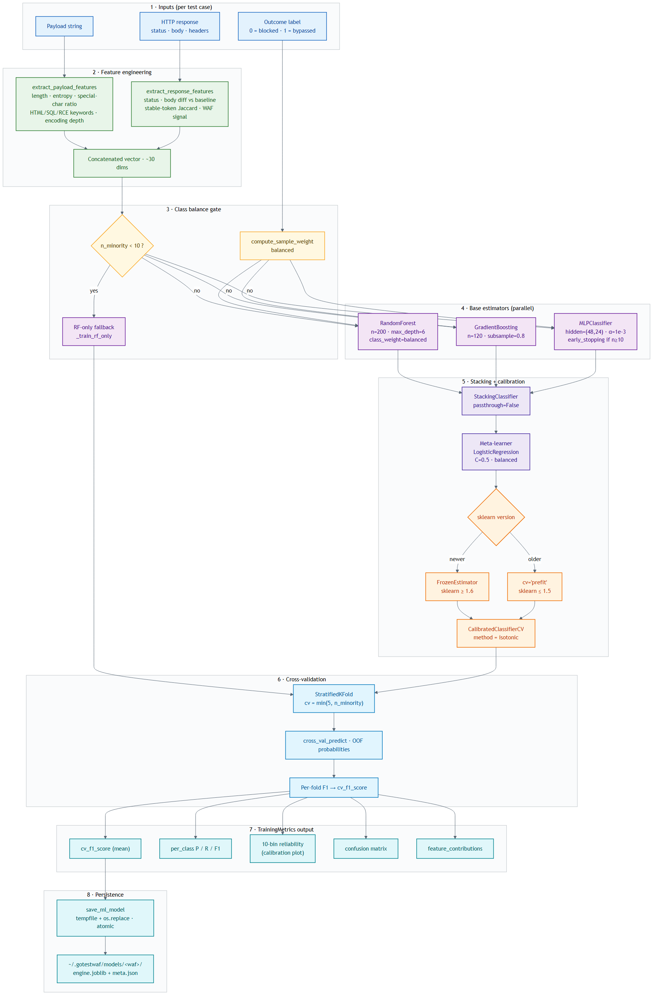

<details>
<summary>Mermaid source</summary>

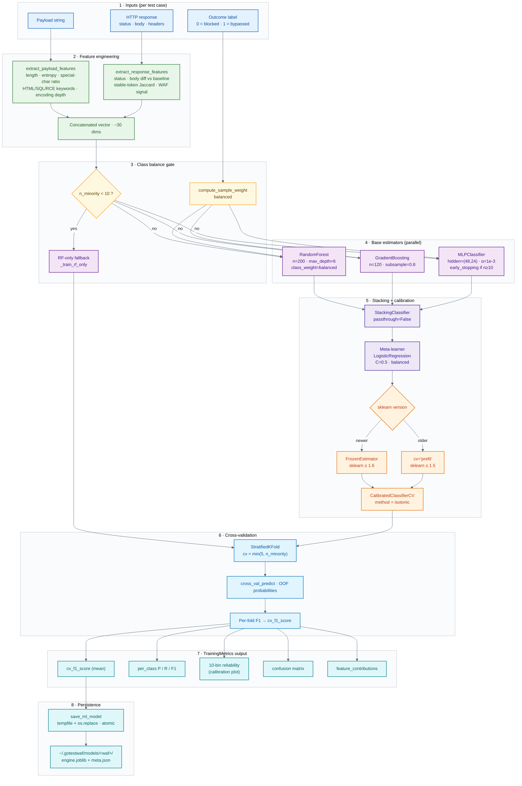

</details>

---

## 3. Prediction / Inference Architecture

How the trained calibrated ensemble scores payloads at runtime. Two paths: (a) **fast mode** — load prior model and reorder upcoming payloads by predicted bypass probability; (b) **adaptive round** — score AI-generated mutations, fire highest-scoring first.


<details>
<summary>Mermaid source</summary>

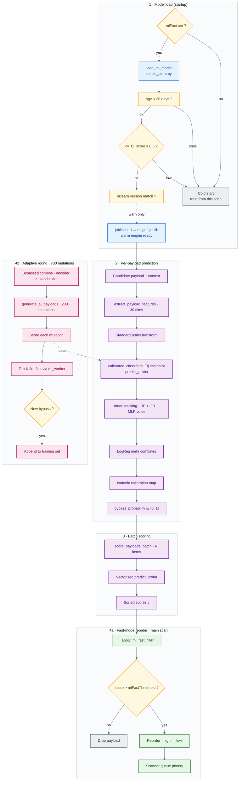

</details>

---

## 4. Response Classification (4-Layer Defense in Depth)

The decision pipeline that turns a single HTTP response into blocked, passed, or unresolved. Every layer is independent and can override; tightening this fixed the TN=0% bug.

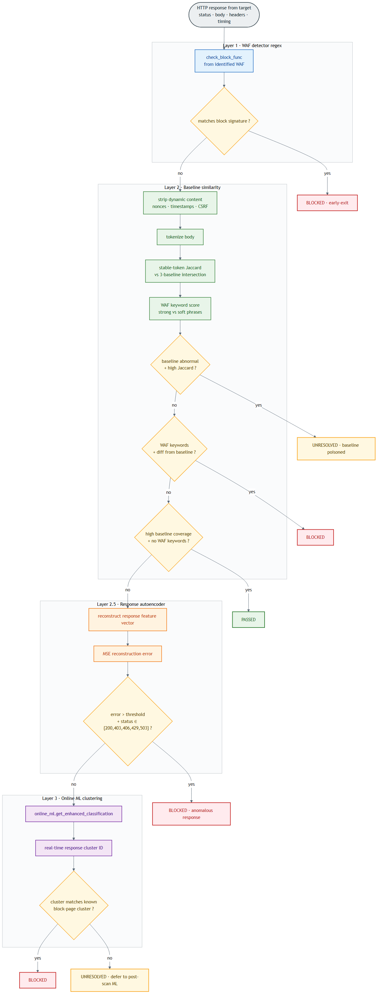

<details>
<summary>Mermaid source</summary>

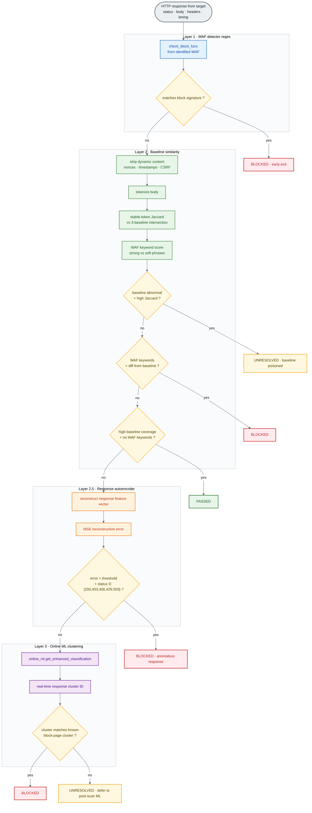

</details>

---

## 5. Adaptive Mutation Engine (700 ML Mutations)

After the main scan + training, the system uses what it learned to attack again — generates AI payloads from the bypass patterns, scores each, fires highest-probability first.

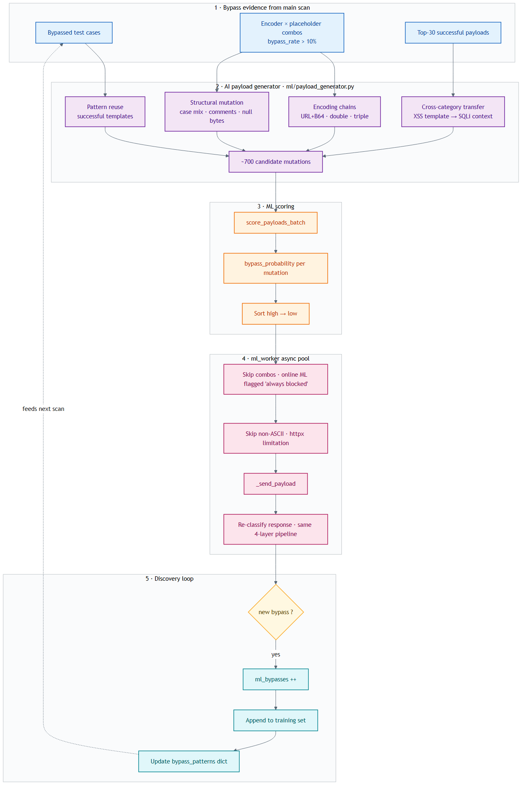

<details>
<summary>Mermaid source</summary>

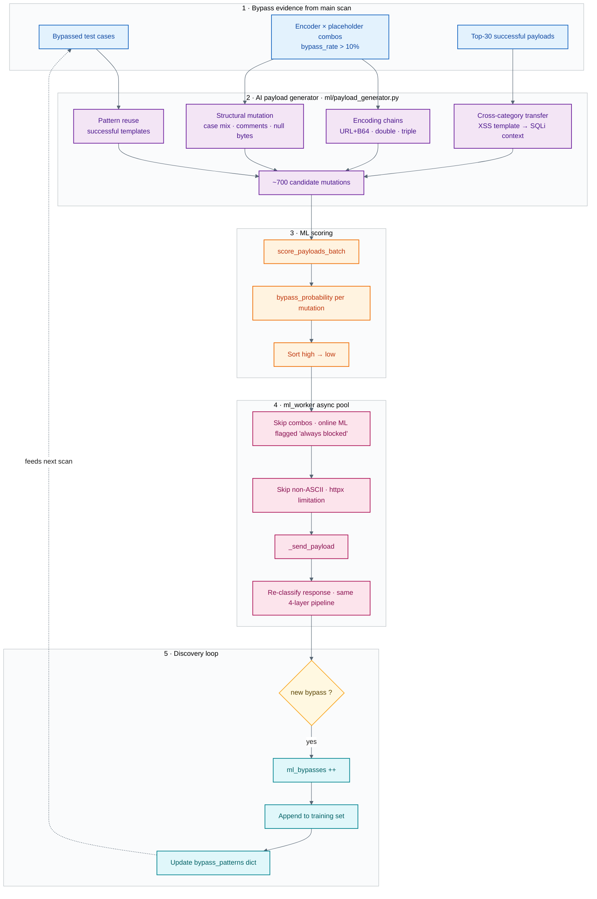

</details>

---

## 6. Autofix → Multi-Cloud IaC Pipeline

How bypassed categories + missing-ruleset inference become deployable Terraform / CloudFormation / Bicep / gcloud artifacts. AWS + Azure + GCP are emitted regardless of detected WAF — SREs on any cloud can pick the right deploy file.


<details>
<summary>Mermaid source</summary>

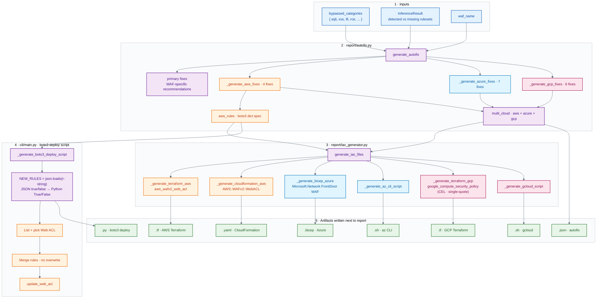

</details>

---

## 7. Cross-Scan Knowledge Persistence

The system gets smarter every scan. Bypass patterns + trained models are keyed by WAF type and reused on the next scan against the same family.

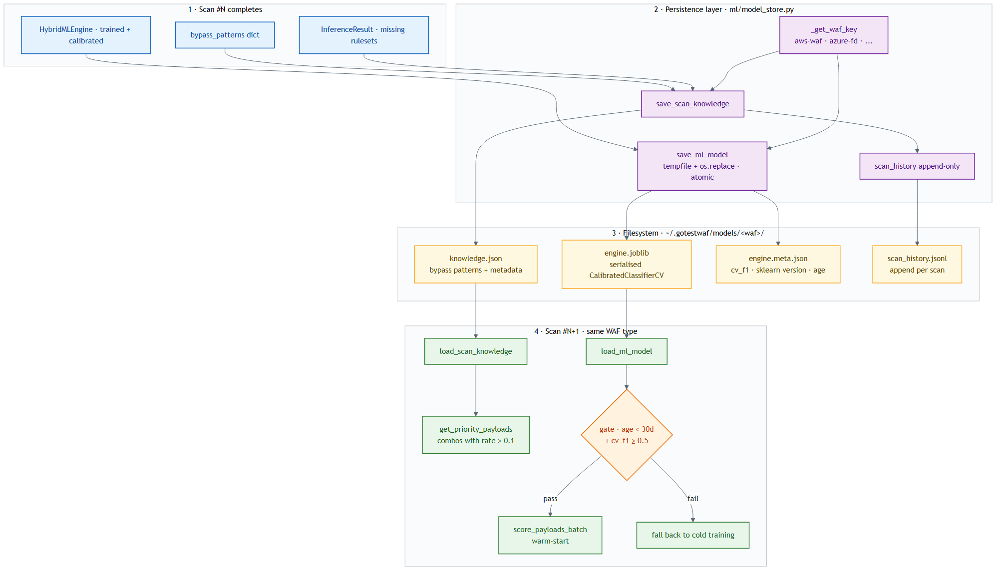

<details>
<summary>Mermaid source</summary>

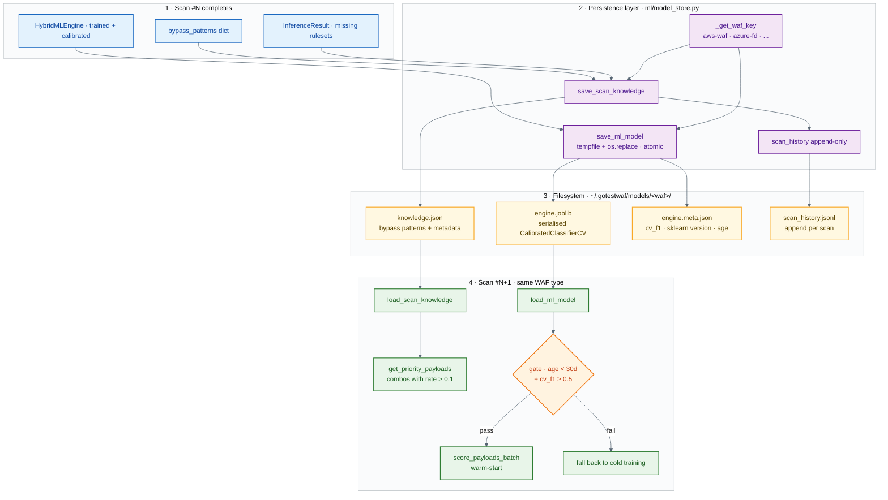

</details>

---

## 8. Reporting Architecture (HTML / 3D / XLSX / CSV)

How scan output, ML metrics, ruleset inference, and autofix data are funnelled into the publication-quality HTML report (27 charts, 3D attack-surface scene, MITRE mapping, light-theme + 2× DPR PNG export).

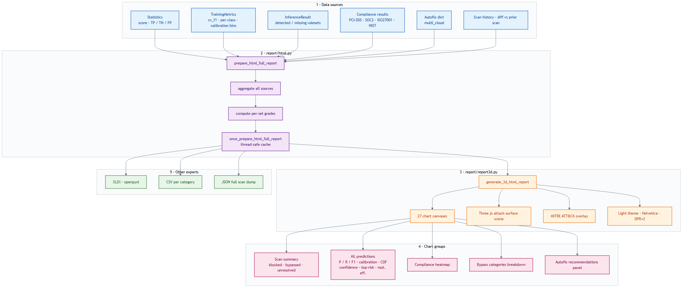

<details>
<summary>Mermaid source</summary>

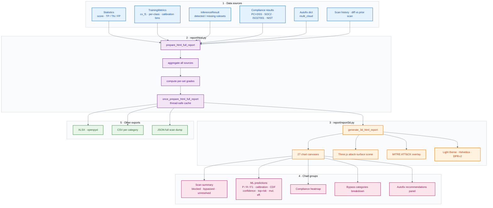

</details>

---

## 9. Full Component Architecture (module map)

A package-level map of the codebase: which modules live in cli/, helpers/, scanner/, ml/, report/, and how they wire together. Use this as the orientation map when reading the source.


<details>
<summary>Mermaid source</summary>

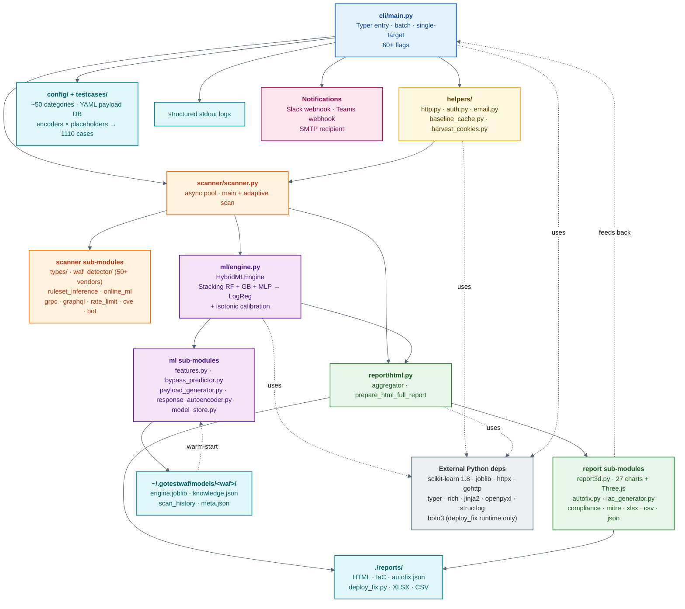

</details>

---

## 10. Deployment Setup Architecture

How pytestwaf runs in production: trigger surface (CLI / cron / CI), Docker image, container process, volume mounts, network egress, secrets, notifications, and the separate operator-driven deploy path that applies the generated IaC.

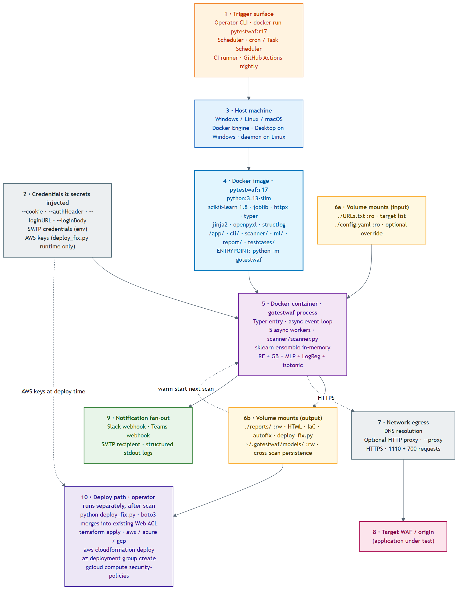

<details>
<summary>Mermaid source</summary>

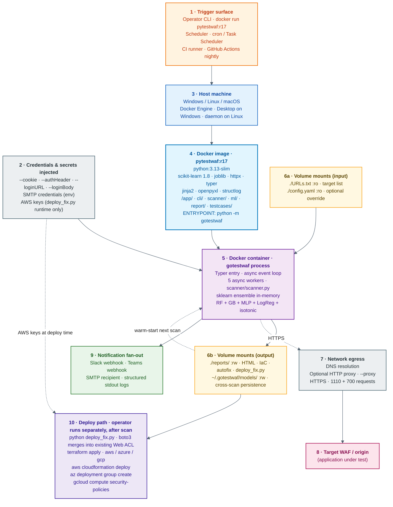

</details>

---

## File reference

| Diagram | Primary source files |
|---|---|
| End-to-end | [cli/main.py](../src/gotestwaf/cli/main.py) — orchestrator |
| Training | [ml/engine.py](../src/gotestwaf/ml/engine.py), [ml/bypass_predictor.py](../src/gotestwaf/ml/bypass_predictor.py) |
| Prediction | [ml/engine.py](../src/gotestwaf/ml/engine.py), [ml/model_store.py](../src/gotestwaf/ml/model_store.py) |
| Classification | [scanner/scanner.py](../src/gotestwaf/scanner/scanner.py) — `_check_blocked_or_passed` |
| Mutation | [ml/payload_generator.py](../src/gotestwaf/ml/payload_generator.py), [scanner/scanner.py](../src/gotestwaf/scanner/scanner.py) — `_run_adaptive_scan` |
| Autofix/IaC | [report/autofix.py](../src/gotestwaf/report/autofix.py), [report/iac_generator.py](../src/gotestwaf/report/iac_generator.py) |
| Persistence | [ml/model_store.py](../src/gotestwaf/ml/model_store.py) |
| Reporting | [report/html.py](../src/gotestwaf/report/html.py), [report/report3d.py](../src/gotestwaf/report/report3d.py) |
| Full architecture | entire [src/gotestwaf/](../src/gotestwaf/) tree |
| Deployment | [Dockerfile](../Dockerfile) |

## Re-rendering

After editing a `.mmd` file, regenerate its PNG:

```powershell
npx -p "@mermaid-js/mermaid-cli" mmdc `
  -i docs/diagrams/01-end-to-end.mmd `
  -o docs/diagrams/01-end-to-end.png `
  -b white --scale 2 `
  -p docs/diagrams/puppeteer-config.json
```
